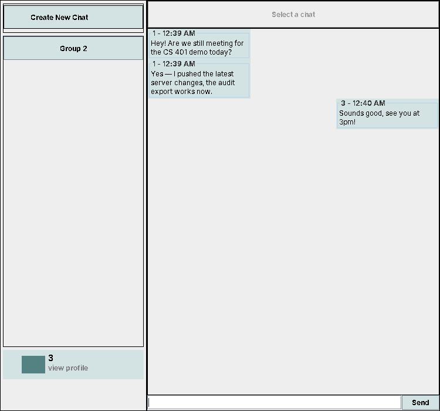
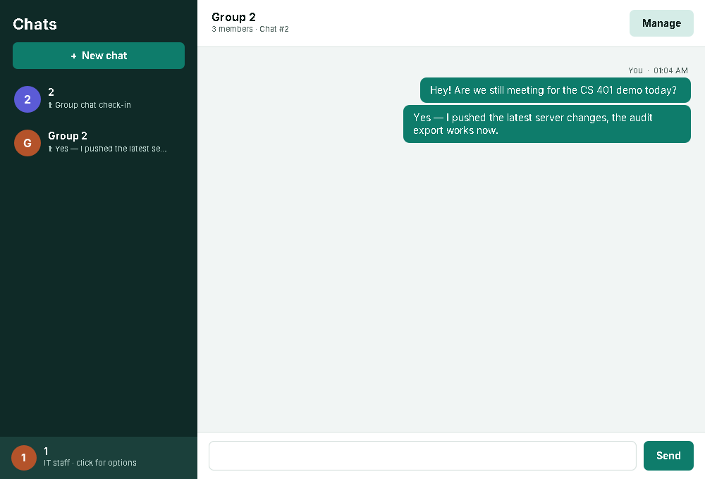
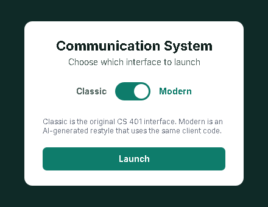
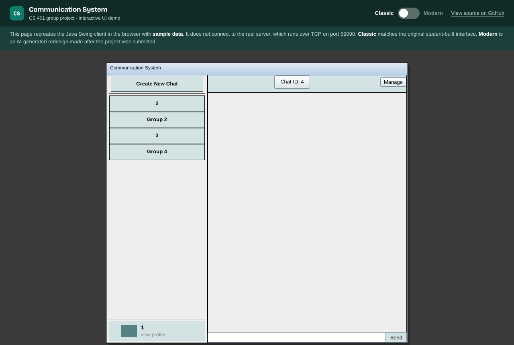
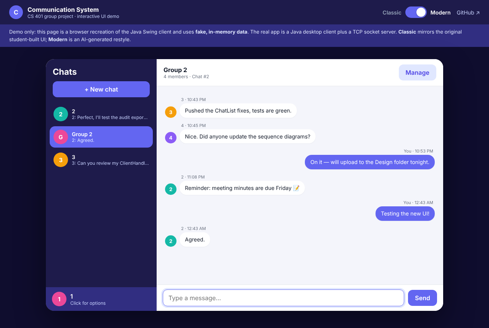
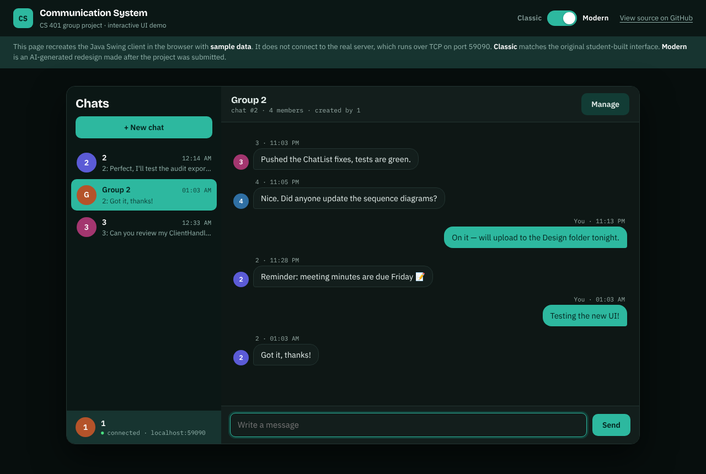

# Communication System

> **Live UI demo:** https://denilson15.github.io/Modern-Communications-App/
> Use the **Classic ⟷ Modern** slider at the top to compare the original interface with the AI-generated redesign.

This repository is a personal copy of our **CS 401: Software Engineering** group project.
The original team repository is here:
**https://github.com/Aircc0615/Communication-System-Group-Project**

| Original (Classic) | AI-generated (Modern) |
|---|---|
|  |  |

---

## About the original project

This project was built as a class assignment for CS 401: Software Engineering. As a team, we went through the full software-engineering process before and during implementation:

- **Requirements:** the Software Requirements Specification, use case specification and diagram, class diagram, sequence diagrams for login/logout and message sending, and meeting minutes ([`Requirements/`](Requirements)).
- **Design:** the design specification, use cases, and design-phase meeting minutes ([`Design/`](Design)).
- **Planning:** the project schedule ([`projectSchedule.pdf`](projectSchedule.pdf), [`Project schedule.csv`](Project%20schedule.csv)).
- **Implementation and testing:** Java source in [`src/`](src) and JUnit tests in [`test/`](test).

### Overview
A scalable, text-only communication system that lets many users send messages to each other. Messages can be sent synchronously or asynchronously, in group chats or private chats. Users can only see messages meant for them, while IT staff can view all messages. Both users and IT staff use the system through the provided GUI.

### Our Communication System
This product is a real-time communication system that runs over a two-way client-server connection. Authenticated users reach the server and send messages over TCP/IP. The product is meant to support a large number of concurrent users, and message history is stored in data files. The system does not rely on an external database, so it is less optimized for keeping large amounts of historical data.

### Constraints
1. The application must be developed in Java.
2. The system does not use databases, libraries, frameworks, or other outside technologies.
3. The system follows standard object-oriented design principles.
4. The application was developed in the Eclipse IDE.

### How to run (original)

**Server:**
- Run `src/networking/Server.java` in Eclipse with no arguments.
- The first run creates 6 test users with no chats. Their usernames and passwords are `1` through `6`.
- Changes are saved on the server, so sending messages updates the server's files.
- Editing the server data files while the server is running does not update the server.
- Server chat files are saved to `LocalFiles/Server`, and user files to `LocalFiles/Users`.

**Client:**
- Run `src/GUI/Main.java` in Eclipse. This opens the original UI exactly as it was submitted.
- By default the client connects to `localhost`. It also accepts an IP address, but only when that is the only argument.
- Exported files are saved to `LocalFiles/IT_Export/Chats`.

For details on using the program, see the Design Specification and the Use Cases PDF.

---

## Modern UI and live demo (added after submission)

> ⚠️ **Disclaimer:** everything in this section was **entirely AI-generated**, after the original project was submitted and graded.
> It is a demonstration layer only. **None of the original source code was changed.** `src/chat`, `src/networking`, `src/user`, `src/GUI/GUI.java`, `src/GUI/Main.java` and all tests are identical to the submitted version.

### What was added

| File | Purpose |
|---|---|
| `src/GUI/Launcher.java` | New entry point. A start screen with a **Classic ⟷ Modern** slider that opens either the original `GUI` or the new `ModernGUI`. |
| `src/GUI/ModernGUI.java` | Modern restyle of the client. It extends the original `GUI` class so it reuses the same `Client`, `User` and `Chat` code: same features, new look. |
| `src/GUI/Theme.java` | Colors, fonts and custom-painted rounded components. Pure Swing, no libraries. |
| `web/` | Static browser recreation of the client for the live demo, with the Classic/Modern slider. |
| `index.html`, `.nojekyll`, `netlify.toml` | Hosting setup for the web demo (GitHub Pages serves the repo root and `index.html` forwards to `web/`). |
| `docs/screenshots/` | Screenshots used in this README. |

### Running the modern desktop UI
1. Start `networking.Server` as usual.
2. Run `src/GUI/Launcher.java` instead of `Main.java`. It accepts the same optional IP argument.
3. Use the slider to pick **Classic** (the original UI) or **Modern**, then click **Launch**.



From the command line:
```bash
javac -d bin $(find src -name '*.java')
java -cp bin networking.Server          # terminal 1
java -cp bin GUI.Launcher [server-ip]   # terminal 2
```

### About the web demo
The original app is a Java Swing desktop client that talks to a Java server over raw TCP sockets, so it can't run in a browser as-is. The [live demo](https://denilson15.github.io/Modern-Communications-App/) is a **front-end-only recreation** built with HTML, CSS and JavaScript. It uses fake, in-memory data, so you can click through the UI (login, chats, sending messages, group management, IT audit mode and export) without installing anything. It does not connect to the real Java server.

Demo accounts: `1` to `5` (the password is the same as the username). IT account: `it` / `it`.

| Web demo: Classic | Web demo: Modern |
|---|---|
|  |  |

The modern web view follows your device's light or dark setting:



---

### Thank you for checking out our repo!
